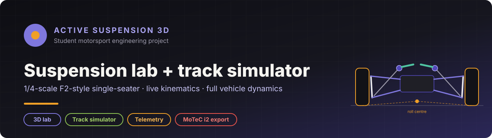
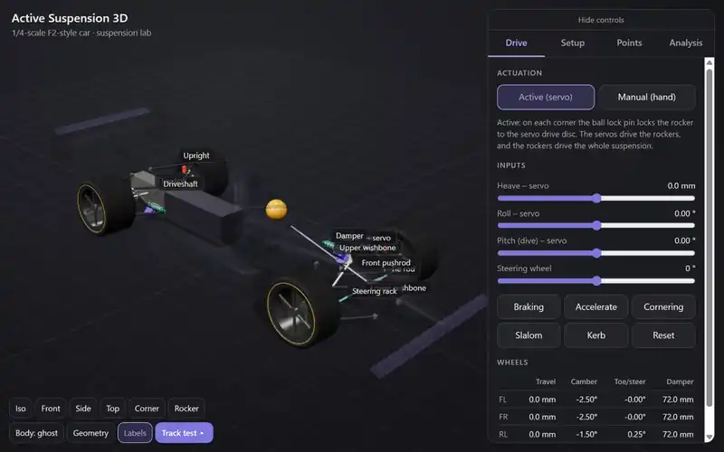
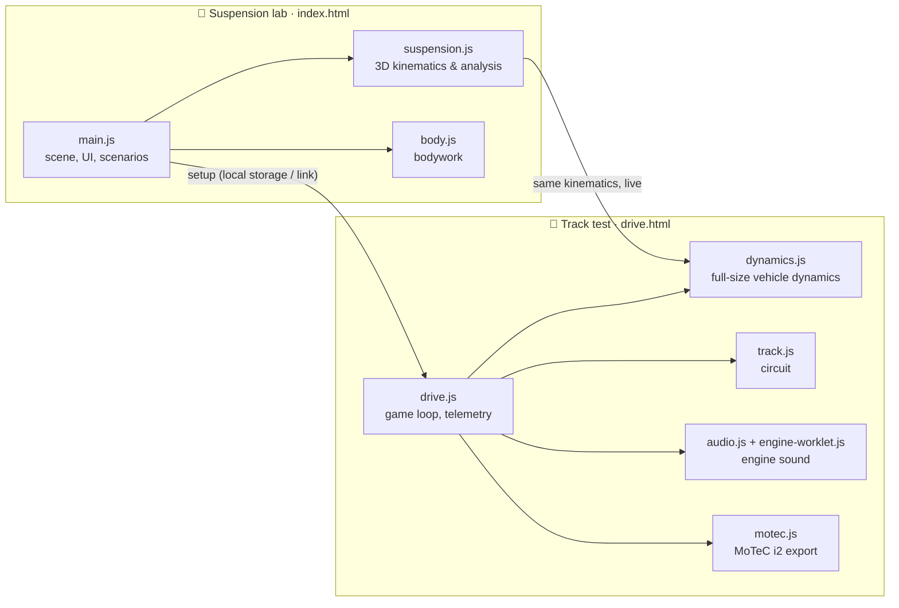

<p align="center">
  <a href="https://active-susp.vercel.app"></a>
</p>

<p align="center">
  <a href="https://active-susp.vercel.app"></a>
  <a href="https://active-susp.vercel.app/drive.html"></a>
</p>

<p align="center">
  <a href="LICENSE"></a>
  
  
  
</p>

<p align="center">
  <b>Learn vehicle dynamics by doing.</b><br>
  Set up the suspension of a 1/4-scale F2-style single-seater in 3D, see live what every setting changes,<br>
  then take the very same car onto a circuit and read the telemetry.
</p>

<p align="center">
  <a href="https://active-susp.vercel.app"></a>
</p>

---

## 🚀 Try it in 30 seconds

| | Where | What to do first |
|---|---|---|
| 🔧 **Suspension lab** | [active-susp.vercel.app](https://active-susp.vercel.app) | Click **Cornering**, then turn on **Geometry** to see the roll centres |
| 🏁 **Track test** | [/drive.html](https://active-susp.vercel.app/drive.html) | Press **Start driving**, hold **↑** and steer with **← →** |
| 🧪 **First version** | [/v1/](https://active-susp.vercel.app/v1/) | The original front-axle demonstrator |

Nothing to install: it all runs in the browser, on desktop, tablet and phone.

---

## ✨ What you can do

<table>
<tr>
<td width="50%" valign="top">

### 🔧 In the lab

- **Move** the suspension: heave, roll, pitch, steering, plus braking, acceleration, cornering, slalom and kerb scenarios.
- **Set up** each axle: camber, toe, caster, KPI, scrub radius, mechanical trail, ball joint heights, ride height, track width.
- **Switch** each axle between **pushrod** and **pullrod**.
- **Drag any pickup point** in 3D with a gizmo, or type its coordinates. The right side mirrors the left.
- **Analyse** roll centres, camber gain, bump steer, motion ratio, anti-dive / anti-squat and Ackermann, with live curves.
- **Share** a setup as a link, or export / import it as JSON.

</td>
<td width="50%" valign="top">

### 🏁 On track

- **Drive** with keyboard, game controller or touch.
- **Full-size simulation** at 240 Hz: Magic Formula tyres, load transfer, aero, 6-speed gearbox, reverse gear.
- **Live kinematics**: roll and pitch change each wheel's camber and steer angle, and so its grip.
- **Telemetry**: tyre loads, grip used, slip angles, balance (understeer / oversteer), g-g diagram, lap traces.
- **Engine sound** built from a physical model of the V6 and its exhaust.
- **MoTeC i2 export**: every session logged at 50 Hz, 45 channels, lap beacons and GPS track map.

</td>
</tr>
</table>

---

## 🎮 Track test controls

| Action | ⌨️ Keyboard | 🎮 Controller |
|---|---|---|
| Throttle / brake | `↑` `W` / `↓` `S` | `RT` / `LT` |
| Steer | `←` `→` / `A` `D` | Left stick |
| Gear up / down | `E` / `Q` | `RB` / `LB` |
| Reset car | `R` | `A` |
| Camera / telemetry / setup | `C` / `T` / `B` | `Y` / `X` / `B` |
| Pause | `P` or `Esc` | `Menu` |
| Sound / export MoTeC | `M` / `L` | |

> [!TIP]
> **Reverse**: once the car is stopped, release the brake and press it again. The brake then drives backwards. Press the throttle at a standstill to go back to first gear.

---

## 📈 Analyse your laps in MoTeC i2

1. Drive a few laps (the log covers up to 60 minutes).
2. Click **Export MoTeC** and allow both downloads: a `.ld` log and its `.ldx` lap file.
3. Keep both files in the same folder and open the `.ld` in **MoTeC i2 Pro**.
4. The channels use MoTeC names, so the standard worksheets recognise them.

---

## ⚙️ Active and manual modes

The physical concept behind the project: each rocker is **coaxial with a servo**. A **ball lock pin** through the rocker hub and the servo's drive disc locks them together, like a dog clutch.

| | 🤖 Active mode | ✋ Manual mode |
|---|---|---|
| Ball lock pin | Through rocker hub and drive disc | Parked in a holster |
| Rocker | Locked to the servo | Free on its bearing |
| Servo power | ON | OFF (holster micro-switch pressed) |
| Who moves the suspension | The servos | The user, by hand |
| Kinematics | **Identical** | **Identical** |

Changing mode: the suspension first returns to static ride height so the pins carry no load. The pins are then parked (manual), or re-inserted once each servo has aligned its disc (active).

---

## 📐 The model

| | |
|---|---|
| Scale | 1/4 of an F2-style car |
| Wheelbase / track | 784 mm / 380 mm front, 365 mm rear |
| Tyre diameter | 168 mm |
| Suspension | Double wishbones on all four corners, push- or pullrod, rockers and dampers |
| Steering | Rack, column and steering wheel at the front; toe links at the rear |
| Axes (ISO) | **x forward, y left, z up**, origin on the ground at the front axle |

The ball joints are not stored directly: they follow from the alignment settings (KPI, caster, scrub radius, trail and ball joint heights). Moving a ball joint by hand updates those settings back.

---

## 🧩 How it works



No build step and no dependencies to install: three.js is loaded from a CDN through an import map.

<details>
<summary><b>📁 Project structure</b></summary>

```
index.html         Lab page layout and UI
style.css          Lab styles (floating panel on desktop, bottom sheet on mobile)
main.js            Three.js scene, UI, scenarios and the active / manual sequencer
suspension.js      3D suspension kinematics and analysis (pure math, no three.js)
kinematics.js      Planar front-corner kinematics (used by v1)
body.js            Lofted F2-style bodywork
drive.html         Track test page (drive.js, drive.css)
dynamics.js        Full-size vehicle dynamics coupled to the suspension kinematics
track.js           Test circuit geometry
audio.js           Engine, tyre and track sounds (Web Audio API)
engine-worklet.js  Physical model of the V6 engine sound (AudioWorklet)
motec.js           MoTeC i2 export (.ld log + .ldx lap beacons)
legal.html         Legal notice and licence
v1/                First version (front axle demonstrator)
```

</details>

<details>
<summary><b>🧮 Use the kinematics on their own (Node.js)</b></summary>

`suspension.js` has no dependency and runs in Node:

```bash
node -e "import('./suspension.js').then(S => { const car = S.buildCar(S.cloneSetup(S.DEFAULT_SETUP)); console.log(S.solveCar(car, { heave: -10 }).fl) })"
```

</details>

---

## 💻 Run locally

```bash
npx serve .
# or
python3 -m http.server 8000
```

Then open http://localhost:8000 (ES modules do not load from `file://`).

**Deploy**: it is a static folder. On [Vercel](https://vercel.com), import the repository with the **Other** framework preset and no build command.

<details>
<summary><b>🔩 Notes for a physical build</b></summary>

- The servo drives the rocker directly, so it must hold the damper load times the rocker arm length. Size the servo (or add a reduction) for the real model mass.
- Support the rocker axle with an outrigger bearing so the servo shaft does not carry the suspension loads.
- Only pull the pin at static ride height, when it carries no load.

</details>

---

## 📜 Licence and credit

© 2026 **Matheo Merlin**. The website, simulator, source code and user guide were created by Matheo Merlin as part of the **Active Suspension 3D student project**, carried out by a project team.

Licensed under [**CC BY-NC 4.0**](https://creativecommons.org/licenses/by-nc/4.0/). See [LICENSE](LICENSE) and the [legal notice](https://active-susp.vercel.app/legal.html).

| ✅ Allowed | 📝 Required | ⛔ Not allowed |
|---|---|---|
| Personal, educational and research use | Credit whenever you share or publish the project or a work based on it | Any commercial use without prior written permission |
| Sharing and modifying | Say if you made changes and keep the copyright notices | Removing the credits or the licence |

Attribution to use:

> Based on *Active Suspension 3D* by Matheo Merlin (https://github.com/Mafuo-git/active-suspension-3d), licensed under CC BY-NC 4.0.

For a commercial licence, contact the author through this repository.

<sub>Versions published before 16 November 2026 were under the MIT License; every version from that date is under CC BY-NC 4.0 only. three.js keeps its own MIT License. "Formula 2", "F2", "MoTeC" and "i2" are trademarks of their owners; this project is not affiliated with them. Concept model for education: the geometry is representative of an F2-style car, not a reproduction of a specific car, and it is not an engineering tool.</sub>
